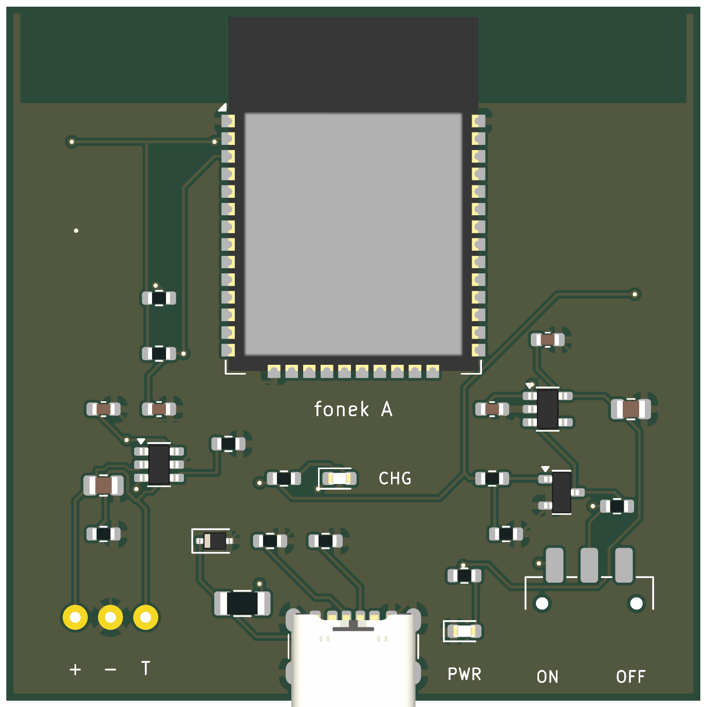
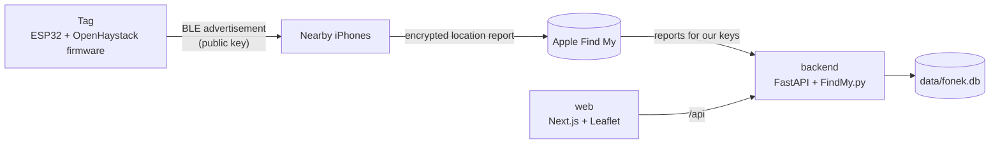

# fonek

Track your own things through Apple's Find My network and see them on your own map, with
hardware you can build yourself.

fonek is three parts that work together:

- **A tag** ([`fonek/`](fonek/README.md)): an open KiCad design for a rechargeable ESP32 BLE
  tag with USB-C charging, plus the [firmware instructions](firmware/README.md) to turn any
  ESP32 dev board into a beacon.
- **A backend** ([`backend/`](backend/)): a FastAPI service that fetches the encrypted
  location reports from Apple with [FindMy.py](https://github.com/malmeloo/FindMy.py),
  decrypts them with the tag's private key and stores them in SQLite. No Mac required.
- **A web app** ([`web/`](web/)): a Next.js + Leaflet dashboard showing each tag's latest
  position and history.

<p align="center">
  
</p>

> **Status: prototype.** The software runs today with an ESP32 dev board. The rev A PCB
> passes KiCad ERC/DRC but has not been built and tested yet; see its
> [release checks](fonek/docs/verification.md). fonek is not an Apple-certified Find My
> accessory and relies on an unofficial Apple API.

## How it works



Each tag has a key pair. The tag broadcasts the public key over Bluetooth. Any iPhone that
passes by encrypts its own location with that key and uploads it to Apple. Only the holder
of the private key can decrypt the report, and that key never leaves your backend.
[docs/architecture.md](docs/architecture.md) goes into the details.

## Quick start

You need Docker, an ESP32 with Bluetooth LE, and an Apple ID with two-factor authentication.
**Use a dedicated Apple ID, not your personal one** (see [Things to know](#things-to-know)).

```bash
git clone https://github.com/lodjim/fonek.git && cd fonek
docker compose up -d --build
docker compose run --rm backend python -m app.cli login   # Apple ID + 2FA, once
```

Then:

1. Open http://localhost:3000 and click **Add device**. fonek generates a key pair and shows
   the advertisement key.
2. Flash that key onto the ESP32, following [firmware/README.md](firmware/README.md).
3. Carry the tag near iPhones. Reports are fetched every 15 minutes, or on demand with
   **Refresh**.

[docs/setup.md](docs/setup.md) covers configuration, backups, updating and troubleshooting.

## Things to know

- **Use a dedicated Apple ID** with 2FA enabled. fonek talks to a private Apple API; an
  account could be rate-limited or locked. Keep the poll interval conservative.
- **Locations are not live.** They arrive only when an iPhone passes near the tag, and
  typically lag by minutes to hours.
- **`data/` holds secrets.** It contains every tag's private key and the Apple session,
  unencrypted. Back it up and keep it private.
- **There is no login on the web app.** Keep it on your LAN and do not expose ports 3000 or
  8000 to the internet.
- **The tag's key is static.** Anyone nearby can recognise the same tag over time.
- **Only track things you own.** Tracking people without their consent is illegal in many
  places and is not what this project is for.

## Repository layout

| Path | What it is |
| --- | --- |
| [`backend/`](backend/) | FastAPI service, poller and CLI (Python 3.11+) |
| [`web/`](web/) | Next.js dashboard |
| [`firmware/`](firmware/README.md) | How to build and flash the OpenHaystack ESP32 firmware |
| [`fonek/`](fonek/README.md) | Rev A tag hardware: KiCad project, Gerbers, BOM, design docs |
| [`docs/`](docs/) | Architecture, setup guide and API reference |
| `docker-compose.yml` | Runs backend and web together |
| `data/` | Created at runtime: database, Apple session (git-ignored) |

## Documentation

- [Architecture](docs/architecture.md): how the pieces fit, the data model, the poller
- [Setup and operation](docs/setup.md): configuration, Apple login, backups, troubleshooting
- [API reference](docs/api.md): the REST endpoints the web app uses
- [Firmware](firmware/README.md): building and flashing the beacon
- [Hardware](fonek/README.md): the rev A tag, its [electrical design](fonek/docs/architecture.md)
  and [verification status](fonek/docs/verification.md)
- [Contributing](CONTRIBUTING.md): development setup and tests

## Development

```bash
# backend
cd backend && python3 -m venv .venv && .venv/bin/pip install -e '.[dev]'
FONEK_DATA_DIR=../data .venv/bin/uvicorn app.main:app --reload
FONEK_DATA_DIR=../data .venv/bin/python -m app.cli seed   # demo device with a fake track
.venv/bin/pytest

# web (proxies /api to http://localhost:8000)
cd web && npm install && npm run dev
```

More in [CONTRIBUTING.md](CONTRIBUTING.md).

## Acknowledgements

fonek stands on other people's work:

- [OpenHaystack](https://github.com/seemoo-lab/openhaystack) by the Secure Mobile Networking
  Lab at TU Darmstadt, which reverse-engineered the Find My protocol and provides the ESP32
  firmware the tag runs.
- [FindMy.py](https://github.com/malmeloo/FindMy.py), which handles the Apple login and
  report decryption.
- Map tiles and data from [OpenStreetMap](https://www.openstreetmap.org/copyright)
  contributors.

fonek is an independent project. It is not affiliated with or endorsed by Apple. Find My and
AirTag are trademarks of Apple Inc.
