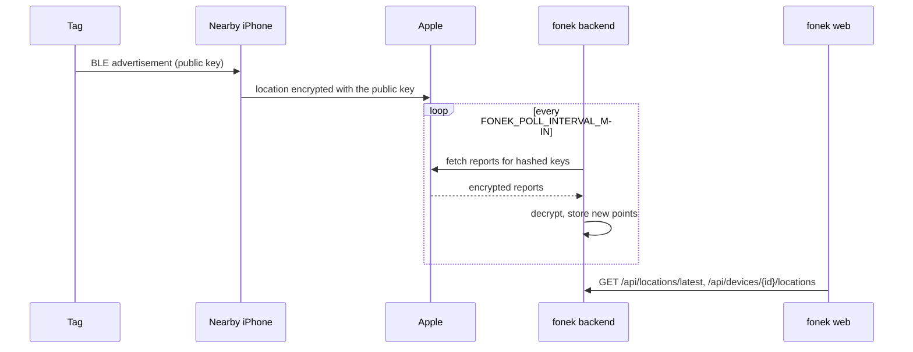
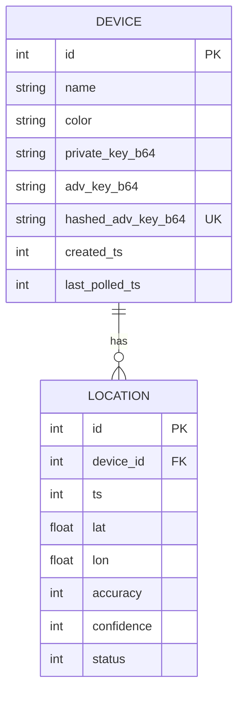

# Architecture

This page describes the software side of fonek. The tag's circuit is documented separately in
[`fonek/docs/architecture.md`](../fonek/docs/architecture.md).

## The Find My trick

Apple's Find My network lets offline devices be located by other people's iPhones. fonek
uses the same mechanism, as documented by the
[OpenHaystack](https://github.com/seemoo-lab/openhaystack) project:

1. Each tag has a P-224 elliptic-curve key pair. The **private key** stays in the backend;
   the **advertisement key** (the public key) is flashed onto the tag.
2. The tag broadcasts the advertisement key in a Bluetooth LE advertisement that looks like
   an offline Apple device.
3. An iPhone that hears it encrypts its own location with that public key and uploads the
   report to Apple, indexed by a hash of the key.
4. The backend asks Apple for the reports matching the hashes of its keys and decrypts them
   with the private keys.

Apple and the reporting iPhone cannot read the location, and neither knows who owns the tag.
The backend does need a logged-in Apple ID to download reports.

## Components

### Backend (`backend/app/`)

A single FastAPI process with a background task.

| File | Role |
| --- | --- |
| `main.py` | App factory; starts the poller on startup unless `FONEK_NO_POLL` is set |
| `config.py` | Settings from `FONEK_*` environment variables; paths inside the data directory |
| `models.py` | SQLModel tables (`Device`, `Location`) and the API request/response schemas |
| `db.py` | SQLite engine, foreign keys on, table creation |
| `apple.py` | `AccountManager`: restores the Apple session, fetches reports through FindMy.py |
| `poller.py` | `Poller`: the periodic fetch loop and on-demand refresh, behind one lock |
| `routes/devices.py` | Device CRUD, location history, per-device refresh |
| `routes/status.py` | Apple session state and latest location per device |
| `cli.py` | `login`, `logout` and `seed` maintenance commands |

**Apple session.** `python -m app.cli login` runs as a separate process, performs the Apple
ID login with 2FA and writes `account.json`. The server re-reads that file whenever its
modification time changes, so logging in does not need a restart. Anisette data (the device
attestation Apple expects) is generated locally by FindMy.py and cached in `anisette_libs`.
After each successful fetch the refreshed tokens are written back to `account.json`.

**Polling.** Every `FONEK_POLL_INTERVAL_MIN` minutes the poller loads all devices, asks
Apple for their history in one request and inserts the results. Apple returns overlapping
history on each call; a unique constraint on `(device_id, ts, lat, lon)` drops the
duplicates. A request to `/api/devices/{id}/refresh` runs the same code for one device. The
lock ensures only one fetch talks to Apple at a time. Apple timeouts are retried up to three
times; the last error is exposed through `/api/status`.

### Data model

Times are stored as Unix seconds in UTC and serialised as ISO-8601 strings. Deleting a
device deletes its locations. The private key is never returned by the API.

### Runtime data (`data/`)

| File | Contents |
| --- | --- |
| `fonek.db` | SQLite database: devices (including private keys) and locations |
| `account.json` | Apple session tokens, mode `0600` |
| `anisette_libs` | Cached libraries FindMy.py uses to generate anisette data |

Nothing in this directory is encrypted. Treat it like a password file.

### Web (`web/`)

A Next.js App Router application with one page. The dashboard polls the backend with SWR
and draws the map with React Leaflet on OpenStreetMap tiles: a marker and accuracy circle
for each tag's latest position, and the selected tag's track. Dialogs add a device and show
its advertisement key with the matching flash command.

The browser only ever talks to the web server. Next.js rewrites `/api/*` to the backend, and
the target (`BACKEND_URL`) is fixed when the image is built.

### Firmware and hardware

The tag runs the unmodified OpenHaystack ESP32 firmware, which only advertises a static key;
see [`firmware/README.md`](../firmware/README.md). Any ESP32 with Bluetooth LE works as a
tag. The [`fonek/`](../fonek/README.md) directory adds a purpose-built rechargeable board.

## Trust boundaries and limitations

- **No authentication.** Anyone who can reach port 3000 or 8000 can see locations, add and
  delete devices, and trigger fetches. Run fonek on a trusted network or put an
  authenticating reverse proxy in front of it.
- **Unofficial API.** Apple can change or block the report endpoint at any time, and may
  rate-limit or lock an account that polls too aggressively.
- **Static keys.** The stock firmware never rotates its key, unlike an AirTag, so the tag
  can be recognised by anyone scanning for it repeatedly.
- **No anti-stalking features.** There is no sound, no separation alert. Only track things
  you own.
