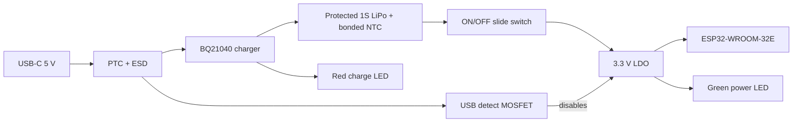

# fonek rev A electrical architecture

## Intended behavior

fonek is a BLE advertisement tag for the fonek/OpenHaystack stack. The chosen ESP32-WROOM-32E is in the same classic ESP32 family as the repository's current firmware. It includes no Wi-Fi use, GPS, UWB, speaker, or USB data. An ON/OFF slide switch is physical, and the green LED is connected to the 3.3 V system rail so it is on only while the tracker is powered. A separate red LED is driven from the charger's active-low CHG output and lights only while a charge cycle is active.

| Switch | USB-C | ESP32 and green LED | Red LED | Battery |
| --- | --- | --- | --- | --- |
| OFF | Unplugged | Off | Off | Isolated from system |
| ON | Unplugged | On | Off | Powers system |
| OFF or ON | Plugged in, charging | Off | On | Charges if temperature allows |
| OFF or ON | Plugged in, charge done/fault | Off | Off | Charger handles battery state |

The red LED **off** state does not by itself prove a full battery: it also occurs with no USB power, a charge fault, or a temperature hold. Product labeling should say “charging” rather than “full.” The green LED indicates that the 3.3 V rail is present, not that Apple's network has seen the tag.

## Electrical decisions

- **USB-C:** The GCT USB4125 is power-only. Each CC contact has its own 5.1 kΩ pull-down. A 500 mA PTC and VBUS ESD diode provide low-cost input protection. This USB port cannot flash the ESP32.
- **Charging:** BQ21040DBVR charges one LiPo cell to 4.2 V. The 6.8 kΩ ISET resistor sets approximately 79 mA nominal fast-charge current using the datasheet's 540 AΩ factor. A 400 mAh pack's reference charge current is 80 mA. The pack must have its own overcharge, overdischarge, overcurrent, and short-circuit protection. The charger's TS input must connect to a **real 10 kΩ, β≈3370 NTC thermistor bonded to the cell**. A 237 kΩ parallel resistor follows TI's guidance to avoid timer-disable mode if the NTC lead opens; verify the resulting temperature thresholds on the prototype. A fixed resistor is not an acceptable substitute for the product design.
- **Power switch and charge isolation:** SW1 connects the protected battery output to SYS_BAT in ON. Q1 pulls the TLV75533PDBVR enable input low whenever USB VBUS is present. This turns off the ESP32 during charging even if the switch is ON, avoiding a shared system load on the charger output. The charger remains connected to the battery when the switch is OFF.
- **Regulation:** The 500 mA TLV75533PDBVR feeds the ESP32 and green LED. Its 3.3 V output requires input and output capacitors close to the regulator and a local 100 nF plus bulk capacitance close to the ESP32. A 3.3 V LDO cannot use the cell's full voltage range; the usable capacity depends on ESP32 current pulses and LDO dropout. Measure this before promising battery life.
- **Indicators:** D1 green has a 6.8 kΩ series resistor and draws roughly 0.2 mA depending on its forward voltage. It is a simple always-on indicator with a real battery cost. D2 red has a 2.2 kΩ resistor from VBUS to the charger CHG pin and draws roughly 1–2 mA only during charging.
- **Programming:** Factory pads expose 3V3, GND, UART TX, UART RX, EN, and GPIO0. A 3.3 V USB-UART fixture provides logic signals; power the board with a protected battery or a current-limited battery emulator. GPIO0 is pulled low and EN pulsed low to enter bootloader mode. USB-C is unplugged during programming. Never connect 5 V UART signals to the ESP32.

The exact pin-to-net assignments and component values are in [`../design/fonek_rev_a.json`](../design/fonek_rev_a.json); the generated [`../design/netlist.csv`](../design/netlist.csv) is a readable export.

## Battery-life planning

The 400 mAh capacity divided by measured average current gives only an **ideal upper bound**. It does not account for regulator dropout, cell aging, cold weather, or transient brownouts. The existing firmware has no measured fonek power budget.

| Measured average current | Ideal 400 mAh upper bound |
| ---: | ---: |
| 5 mA | 80 hours |
| 15 mA | 27 hours |
| 30 mA | 13 hours |

The green LED consumes approximately 0.2 mA while powered. If a measured battery life target is missed, an ESP32 firmware sleep strategy and lower-power indicator behavior should be evaluated before reducing cell protection or RF margins. A future lower-power radio would require a different firmware port.

## Physical and cost direction

Rev A is a 50 × 50 mm, 2-layer, 1.0 mm board with USB-C at one edge and the ESP32 antenna at the opposite edge. The board has copper keepout on both layers under and beyond the module antenna. The battery attaches through three solder holes; its mechanical retention, lead strain relief, enclosure, light windows, and any key-ring feature remain to be designed. Keep the pouch cell, switch metal, USB shell, and key-ring hardware away from the antenna. The battery's roughly 6 mm thickness will likely drive enclosure thickness.

The low-cost approach is one pre-certified RF module, a power-only USB-C connector, a small SOT-23 charger and regulator, 0603 passives, and no GPS/UWB/speaker. The protected **three-wire battery pack with NTC** is a sourcing gate and may cost more than the earlier two-wire candidate. Obtain volume quotes before claiming a selling price or AirTag price parity.

## Key limitations

The current repository firmware advertises a static OpenHaystack key, so a nearby observer may recognize the same tag over time. The fonek backend uses unofficial Apple access. fonek is not registered or certified as an Apple Find My accessory, and does not provide AirTag precision finding or audible finding. Validate legal, privacy, and anti-stalking requirements before any public sale.

## Manufacturer references

- [Espressif ESP32-WROOM-32E datasheet](https://documentation.espressif.com/esp32-wroom-32e_esp32-wroom-32ue_datasheet_en.html)
- [TI BQ21040 charger datasheet](https://www.ti.com/lit/ds/symlink/bq21040.pdf)
- [TI TLV755P regulator datasheet](https://www.ti.com/lit/ds/symlink/tlv755p.pdf)
- [GCT USB4125 product page](https://gct.co/connector/usb4125)
- [C&K JS series switch datasheet](https://www.ckswitches.com/media/1422/js.pdf)
- [Nexperia PESD5V0S1BA product page](https://www.nexperia.com/product/pesd5v0s1ba)
- [F&P LP602525 two-wire battery size/current reference](https://www.fpbattery.com/wp-content/uploads/2023/10/602525-3.7V-400mAh-Specification.pdf) — this is **not** the specified three-wire NTC pack.
